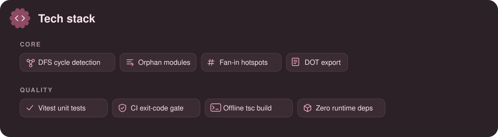

<p align="center">
  
</p>
<p align="center">
  <a href="https://github.com/Celine1337/importgraph/releases"></a>
  <a href="https://graphviz.org/doc/info/lang.html"></a>
  <a href="LICENSE"></a>
</p>


**importgraph** turns any JavaScript/TypeScript directory into a **module graph** and tells you the three things code review keeps missing: **circular dependencies**, **orphan modules**, and **fan-in hotspots**. Point it at a source tree, and it parses every `import`, `export … from`, `require()` and dynamic `import()` (regex-based, so it works on any dialect without a parser dependency), resolves relative specifiers to real files — including the TS-ESM `./foo.js` → `foo.ts` mapping and directory `index` resolution — and runs a pure, side-effect-free graph core over the result.

Cycles are not cosmetic: they break tree-shaking, create temporal-dead-zone crashes at module init, and make refactors terrifying. Orphans are dead code or unwired entry points. Fan-in hotspots are the modules whose change radius is largest — the ones to stabilize first. importgraph reports all three, and **exits `1` when cycles exist**, so it drops straight into CI as a gate. `--dot` emits Graphviz DOT for rendering the graph as an SVG.

The analysis core (`src/graph.ts`) is a set of **pure functions** — iterative DFS cycle detection, orphan/fan-in measurement, DOT rendering — unit-tested with vitest and reusable as a library. The CLI is a thin shell over it.


- **Cycle detection** — iterative DFS finds every distinct directed cycle (self-loops included), deduplicated by canonical rotation, printed as readable `a.ts -> b.ts -> a.ts` paths. Deep graphs cannot overflow the stack.
- **Orphan modules** — files with zero incoming and zero outgoing import edges, listed explicitly.
- **Fan-in hotspots** — modules imported by ≥ 2 others, ranked by importer count: your refactor risk map.
- **CI-ready exit codes** — `0` acyclic, `1` cycles found, `2` bad usage/directory. Gate your pipeline on real structure, not vibes.
- **Graphviz DOT export** — `--dot` prints a `digraph` you can pipe to `dot -Tsvg` for a visual architecture map.
- **Dialect-agnostic parsing** — `.ts/.tsx/.js/.jsx/.mjs/.cjs/.mts/.cts`, ESM + CommonJS + dynamic imports; `node_modules`, `dist`, `coverage` and dot-dirs skipped.
- **Pure, tested core** — 33 vitest assertions over the graph and parser functions; fixture-tree CLI tests assert exit codes and output.
- **Offline after install** — `build.sh` compiles with the local `tsc`; the `bin/importgraph` wrapper runs `node dist/main.js` with zero runtime dependencies.




Requires Node 18+ and npm. One install, then everything works offline:

```bash
git clone https://github.com/Celine1337/importgraph.git
cd importgraph
npm install         # dev toolchain: typescript, vitest, @types/node
./build.sh          # tsc -> dist/, writes bin/importgraph
./bin/importgraph ./src
```

Or use it as a library — the graph core is exported from `dist/graph.js`:

```js
import { findCycles, findOrphans, hotspots } from "importgraph/dist/graph.js";
```


```bash
importgraph ./src            # human report; exit 1 if cycles
importgraph ./src --dot      # Graphviz DOT on stdout
importgraph ./src --dot | dot -Tsvg > graph.svg
```

```text
$ importgraph ./src
Scanned 7 modules (5 import edges) in ./src

Cycles: 1
  [1] src/a.ts -> src/b.ts -> src/a.ts

Orphans: 1
  src/lonely.ts

Fan-in hotspots (>= 2 importers):
  src/util.ts (3 importers)

Result: 1 cycle(s) found — CI gate FAILS
```

Exit codes: `0` no cycles, `1` cycles found (CI gate), `2` bad usage or unreadable directory. Run `./test.sh` for the full suite: vitest unit tests plus fixture trees covering cycles, orphans, hotspots, `require()` parsing, DOT output and every exit code.


MIT — see [LICENSE](LICENSE).